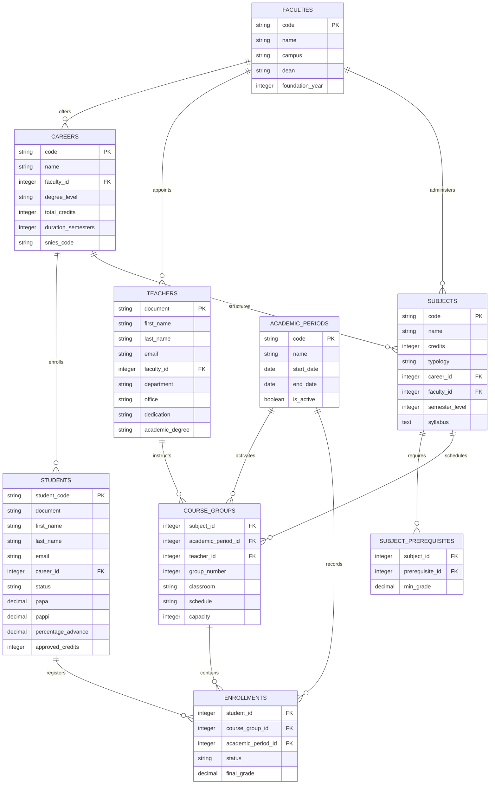

# UNAL SIA: Sistema de Informacion Academica
### Plataforma de Modelado Curricular, Calculo de PAPA y Auditoria Academica
**Universidad Nacional de Colombia (Sede Bogota)**

[](https://github.com/KevinAndrey96/rails-unacional-sia-academic-information-system/actions/workflows/ci.yml)
[](https://rubyonrails.org/)
[](https://www.ruby-lang.org/)
[](https://www.sqlite.org/)
[](https://www.docker.com/)
[](https://unal.edu.co/)

---

## 🏛️ Vision General e Institucional

El **SIA (Sistema de Informacion Academica)** es la plataforma transaccional y de gestion curricular central de la **Universidad Nacional de Colombia**. Orquesta la trayectoria estudiantil, la oferta de facultades, programas curriculares de pregrado y posgrado, asignaturas clasificadas por tipologias, prerrequisitos en grafos de dependencias, inscripcion de cursos y la emision de historias academicas oficiales.

Este repositorio implementa el modelo de dominio formal del SIA bajo **Ruby on Rails**, codificando las reglas pedagogicas y matematicas oficiales estipuladas en el **Estatuto Estudiantil (Acuerdo 008 de 2008 del Consejo Superior Universitario - CSU)**.

---

## 📐 Formulaciones Matematicas Oficiales del SIA

### 1. PAPA (Promedio Aritmetico Ponderado Acumulado)
El PAPA es la metrica determinante del rendimiento global de un estudiante en la Universidad Nacional. Pondera cada calificacion final definitiva por el peso en creditos de la asignatura cursada:

$$\text{PAPA} = \frac{\sum_{i=1}^{n} (\text{Calificacion}_i \times \text{Creditos}_i)}{\sum_{i=1}^{n} \text{Creditos}_i}$$

*Donde:*
- $\text{Calificacion}_i \in [0.0, 5.0]$ es la nota definitiva obtenida en la asignatura $i$.
- $\text{Creditos}_i \in \mathbb{N}^+$ representa las unidades de credito asociadas al curso.
- En la Universidad Nacional de Colombia, la nota minima aprobatoria en pregrado es **3.0 / 5.0**.

### 2. PAPPI (Promedio Aritmetico Ponderado del Periodo)
Calcula el desempeno semestral exclusivo de un periodo academico determinado $t$ (e.g. 2024-2, 2025-1, 2025-2):

$$\text{PAPPI}_t = \frac{\sum_{j \in t} (\text{Calificacion}_j \times \text{Creditos}_j)}{\sum_{j \in t} \text{Creditos}_j}$$

### 3. Porcentaje de Avance de Carrera (PA)
Mide el progreso del estudiante frente a los creditos totales exigidos por el plan curricular del programa (e.g. 165 creditos para Ingenieria de Sistemas y Computacion):

$$\text{PA} = \min\left(100.0, \frac{\text{Creditos Aprobados Acumulados}}{\text{Creditos Totales del Programa Curricular}} \times 100.0\right)$$

---

## 🏷️ Taxonomia Curricular de Asignaturas (Acuerdo 008 de 2008 CSU)

Toda asignatura en la Universidad Nacional pertenece a una de las siguientes cuatro tipologias academicas:

| Tipologia | Denominacion Oficial | Descripcion y Proposito |
| :---: | :--- | :--- |
| **B** | **Basica de Facultad** | Fundamentos cientificos, matematicos, fisicos y teoricos comunes a todas las carreras de una misma facultad (e.g., Programacion Orientada a Objetos, Calculo, Fisica). |
| **P** | **Disciplinar u Obligatoria** | Nucleo duro y especifico de la profesion, sin el cual no es posible otorgar el titulo profesional (e.g., Estructuras de Datos, Redes de Computadores, Sistemas Operativos). |
| **O** | **Optativa / Elegible** | Asignaturas electivas dentro de lineas de profundizacion y especializacion ofrecidas por el departamento academico (e.g., Inteligencia Artificial, Criptografia). |
| **L** | **Libre Eleccion** | Cursos interdisciplinarios elegidos libremente de cualquier facultad o sede del pais para complementar la formacion humanistica y cultural (e.g., Catedras de Sede, Idiomas). |

---

## ⚖️ Condicion Academica y Cupos Semestrales de Creditos

El Estatuto Estudiantil regula la capacidad semestral de matricula con base en el PAPA acumulado del estudiante:

| Rango de PAPA | Condicion Academica | Cupo Maximo de Creditos | Regla Administrativa CSU |
| :---: | :---: | :---: | :--- |
| **PAPA $\ge$ 4.5** | **Matricula de Honor** | **24 Creditos** | Sobrecarga academica autorizada y exencion de matricula. |
| **4.0 $\le$ PAPA < 4.5** | **Excelente** | **24 Creditos** | Sobrecarga academica por alto rendimiento. |
| **3.5 $\le$ PAPA < 4.0** | **Sobresaliente** | **20 Creditos** | Cupo semestral ampliado. |
| **3.0 $\le$ PAPA < 3.5** | **Normal** | **16 Creditos** | Cupo regular de matricula. |
| **PAPA < 3.0** | **Riesgo Academico** | **12 Creditos** | Bloqueo de sobrecarga y seguimiento por tutores academicos. |

---

## 🧩 Modelo Entidad-Relacion (ERD)



---

## 🏛️ Servicios de Dominio y Capa de Negocio

El sistema implementa arquitectura orientada a servicios desacoplada de los controladores en `app/services/`:

1. **`PapaCalculatorService`:**
   - Calcula PAPA acumulado y PAPPI por periodo academico.
   - Computa porcentaje de avance (PA) contra creditos totales del programa curricular.
   - Evalua estado academico (Matricula de Honor, Excelente, Sobresaliente, Normal, Riesgo).
   - Determina el cupo maximo de creditos semestrales segun el Acuerdo 008 de 2008.

2. **`PrerequisiteValidatorService`:**
   - Valida grafos de prerrequisitos de asignaturas antes de autorizar la matricula.
   - Verifica que el estudiante no haya aprobado previamente la asignatura.
   - Inspecciona cruces de periodos activos y disponibilidad de plazas en el grupo.
   - Impide la sobrecarga de creditos si excede el cupo permitido para su PAPA.

3. **`AcademicAuditService`:**
   - Construye la auditoria curricular completa para la Historia Academica Oficial.
   - Desglosa creditos aprobados por tipologia (B, P, O, L).
   - Compila historiales semestrales con calculo de PAPPI individual.
   - Genera firmas digitales de verificacion criptografica (Hash MD5).

---

## 🚀 Despliegue con Docker Compose

### Requisitos Previos
- Docker Engine 20+ y Docker Compose v2.

### Inicio Instantaneo
```bash
# 1. Clonar el repositorio
git clone https://github.com/KevinAndrey96/rails-unacional-sia-academic-information-system.git
cd rails-unacional-sia-academic-information-system

# 2. Levantar el contenedor
docker compose up -d

# 3. Inicializar esquema relacional y semillas curriculares de la UNAL
docker compose exec web bundle exec rake db:schema:load
docker compose exec web bundle exec rake db:seed

# 4. Acceder al aplicativo
open http://localhost:3000
```

---

## 🧪 Suite de Verificacion Automatizada

El proyecto incluye un validador integral en Python que evalua de forma determinista la arquitectura, formulas y reglas del dominio:

```bash
python3 scripts/verify_unacional_sia.py
```

### Suites Evaluadas (7/7):
- **Suite 1:** Academic MVC Architecture & File Completeness (41 archivos de arquitectura).
- **Suite 2:** Database Schema & Relational Tables (9 tablas e indices relacionales).
- **Suite 3:** Official UNAL PAPA & PA Mathematical Formulation (precision KaTeX/LaTeX).
- **Suite 4:** Academic Standing & Credit Quota Rules (Acuerdo 008 de 2008 CSU).
- **Suite 5:** UNAL Curricular Taxonomy & Domain Validation (Tipologias B/P/O/L y `@unal.edu.co`).
- **Suite 6:** Curricular Seeds & Entity Integrity (Facultades, Docentes, Estudiantes).
- **Suite 7:** Zero Em-Dash Quality Rule (conformidad estricta sin guiones largos).

---

## 👨‍💻 Autor & Credenciales Academicas

**Kevin Andrey Herrera Silva**  
- Ingeniero de Sistemas y Computacion, **Universidad Nacional de Colombia (Sede Bogota)** (2017 - 2022).
- Tecnologo en Sistematizacion de Datos (*Tesis Meritoria*), **Universidad Distrital Francisco Jose de Caldas** (2013 - 2017).
- Senior Backend Engineer & Software Architect.
- Perfil GitHub: [@KevinAndrey96](https://github.com/KevinAndrey96)
